# Aurodle — Module Dependency Graph

> Reflects the codebase after Phase 10, the core decoupling cleanups (`f3e3bd7`).
> Supersedes `module-graph_status10.md`.
> Sentrux scan: 2026-11-13, quality signal 6591/10000.
>
> **Conventions:**
> - **`color.zig`** is frontend-only now. Only the `term → color` edge is drawn; `commands/*` and `main` also import it, but those edges are omitted for readability. No Layer 0–3 module imports it.
> - **`root.zig`** is omitted (test discovery only).
> - **Test-only files** (`*/tests.zig`, `*/mocks.zig`, `git/test_repo.zig`) have dashed borders and are not drawn as edge targets.
> - **Thick arrows (`==>`)** mark the longest dependency chain (depth 12).

```mermaid
flowchart TD
    %% ── External systems ──────────────────────────────────────────────────
    C_libalpm(["libalpm\n(C library)"])
    AUR_API(["AUR RPC\n(HTTPS)"])
    AUR_status(["status.archlinux.org\n(HTTPS)"])
    devtools(["devtools\nmkarchroot · makechrootpkg"])

    %% ── Layer 0 — Primitives (leaves) ────────────────────────────────────
    subgraph L0["Layer 0 · Primitives"]
        utils["utils\nIo · process execution\nparallelFor · buffered stdout"]
        provider["provider\nProviderCandidate\nProviderChooser\nProviderSelection"]
        source["source\nSource enum"]
        report["report\nReporter · Level"]
    end

    %% ── Layer 1 — Infrastructure ──────────────────────────────────────────
    subgraph L1["Layer 1 · Infrastructure"]
        alpm["alpm\nlibalpm FFI"]
        aur["aur\nAUR HTTP client"]
        git["git\nclone / fetch\napplyUpstream"]
        auth["auth\nsudo / su wrapper\nkeepalive"]
        chroot["chroot\nclean chroot setup\npacman.conf · staging"]
        repo["repo\nlocal pacman repo\nrepo-add · clean"]
        makepkg["makepkg\nmakepkg.conf parsing"]
        repo_conf["repo_conf\nrepo name derivation"]
        pacman_conf["pacman_conf\nPacmanConf\nregisterSyncDbs"]
        version["version\nVersionConstraint\ncheckVersion"]
        plan["plan\nBuildPlan · BuildEntry\nDependencyEntry · Conflict"]
    end

    %% ── Layer 2 — Domain ─────────────────────────────────────────────────
    subgraph L2["Layer 2 · Domain"]
        pacman["pacman\nlibalpm domain layer\ninstalled / sync queries"]
        devel["devel\nVCS version check\nsource stamps"]
        dep_spec["dep_spec\nDepSpec\nparseDep"]
    end

    %% ── Layer 3 — Resolution ─────────────────────────────────────────────
    subgraph L3["Layer 3 · Resolution"]
        registry["registry\nmulti-source lookup\ninstalled→sync→AUR→provider"]

        subgraph solver_grp["solver (façade + sub-modules)"]
            solver["solver.zig\norchestrator\nBFS · plan assembly"]
            s_graph["solver/graph\nDepGraph · alias resolution"]
            s_topo["solver/topo\nKahn topo sort"]
            s_conflicts["solver/conflicts\nconflict detection"]
        end
    end

    %% ── Layer 4 — Commands (frontend) ────────────────────────────────────
    subgraph L4["Layer 4 · Commands (frontend)"]
        term["term\nconfirm · provider prompts"]
        color["color\nANSI styling"]
        types["commands/types\nFlags · ExitCode · writers\nstderrReporter"]
        q_ctx["commands/query_context\nQueryContext"]
        b_ctx["commands/build_context\nBuildContext · newSolver"]
        display["commands/display\ndisplayPlan\ndisplayInstallList"]
        outdated["commands/outdated\ncollectOutdated\ncheckDevelPackages"]
        commands["commands.zig\npure router"]

        query["commands/query\ninfo · search · outdated"]
        analysis["commands/analysis\nresolve · buildorder"]
        status["commands/status\nArch status page"]

        build_cmd["build_cmd.zig\norchestrator\nclone · sync · upgrade · clean"]
        b_execute["build_execute\nmakepkg · makechrootpkg\nfailure propagation"]
        b_install["build_install\npacman invocations\nprovider selection"]
        b_review["build_review\nPKGBUILD review\ndiff · conflict prompts"]
    end

    %% ── Layer 5 — Entry point ────────────────────────────────────────────
    main["main\nCLI parse · dispatch · wiring"]

    %% ── Test files (dashed, wired through root.zig) ──────────────────────
    s_tests["solver/tests\n+ solver/mocks"]
    r_tests["registry/tests\n+ registry/mocks"]
    pt["pacman/tests\n+ pacman/mocks"]
    rt["repo/tests"]
    gt["git/tests\n+ git/test_repo"]
    at["aur/tests"]

    %% ── External links ───────────────────────────────────────────────────
    alpm --> C_libalpm
    aur  --> AUR_API
    status --> AUR_status
    chroot --> devtools

    %% ── Critical path (depth 12) ─────────────────────────────────────────
    main ==> commands
    commands ==> build_cmd
    build_cmd ==> outdated
    outdated ==> b_ctx
    b_ctx ==> solver
    solver ==> s_conflicts
    s_conflicts ==> registry
    registry ==> pacman
    pacman ==> dep_spec
    dep_spec ==> version
    version ==> alpm
    alpm ==> utils

    %% ── Layer 1 edges ────────────────────────────────────────────────────
    aur --> utils
    git --> utils
    auth --> utils
    chroot --> auth & report & utils
    repo --> makepkg & repo_conf & report & utils
    makepkg --> utils
    repo_conf --> utils
    pacman_conf --> alpm & utils
    plan --> provider & source

    %% ── Layer 2 edges ────────────────────────────────────────────────────
    pacman --> alpm & pacman_conf & provider & repo & version
    devel --> git & utils

    %% ── Layer 3 edges ────────────────────────────────────────────────────
    registry --> alpm & aur & dep_spec & devel & provider & source
    solver --> aur & plan & registry & s_graph & s_topo & version
    s_graph --> aur & source
    s_topo --> s_graph
    s_conflicts --> plan & s_graph

    %% ── Layer 4 — frontend support ───────────────────────────────────────
    term --> color & provider & utils
    types --> aur & plan & report & term & utils

    %% ── Layer 4 — contexts ───────────────────────────────────────────────
    q_ctx --> types & aur & pacman & registry
    b_ctx --> types & aur & auth & pacman & registry & repo

    %% ── Layer 4 — commands ───────────────────────────────────────────────
    commands --> query & analysis & status
    display --> types & devel & pacman & plan
    outdated --> types & devel & git & pacman & registry & utils
    query --> types & q_ctx & b_ctx & outdated & aur & devel & pacman & registry
    analysis --> types & b_ctx & display & registry & solver
    status --> types & utils
    build_cmd --> types & b_ctx & q_ctx & b_execute & b_install & b_review & display & aur & devel & git & pacman & repo & solver & term & utils
    b_execute --> types & b_ctx & auth & chroot & devel & git & plan & repo & utils
    b_install --> types & b_ctx & pacman & plan & registry & repo & term & utils
    b_review --> types & b_ctx & git & plan & term & utils

    %% ── entry point ──────────────────────────────────────────────────────
    main --> types & q_ctx & b_ctx & aur & auth & git & pacman & registry & repo & term & utils

    %% ── test file edges (dashed, not targets) ───────────────────────────
    s_tests -.-> solver
    r_tests -.-> registry
    pt -.-> pacman
    rt -.-> repo
    gt -.-> git
    at -.-> aur

    %% ── styling ──────────────────────────────────────────────────────────
    classDef external  fill:#1a1a2e,stroke:#4a4a8a,color:#aaaaff
    classDef prim      fill:#1e3a2f,stroke:#3a7a5a,color:#aaffcc
    classDef infra     fill:#2a2a1e,stroke:#7a7a3a,color:#ffffaa
    classDef domain    fill:#2a1e2a,stroke:#7a3a7a,color:#ffaaff
    classDef resolv    fill:#2a1e1e,stroke:#8a3a3a,color:#ffaaaa
    classDef cmd       fill:#1e2a3a,stroke:#3a6a9a,color:#aaccff
    classDef entry     fill:#3a2a1e,stroke:#9a6a3a,color:#ffccaa
    classDef testonly  fill:#1a1a1a,stroke:#5a5a5a,color:#aaaaaa,stroke-dasharray: 5 5

    class C_libalpm,AUR_API,AUR_status,devtools external
    class utils,provider,source,report prim
    class alpm,aur,git,auth,chroot,repo,makepkg,repo_conf,pacman_conf,version,plan infra
    class pacman,devel,dep_spec domain
    class registry,solver,s_graph,s_topo,s_conflicts resolv
    class term,color,commands,types,q_ctx,b_ctx,display,outdated,query,build_cmd,b_execute,b_install,b_review,analysis,status cmd
    class main entry
    class s_tests,r_tests,pt,rt,gt,at testonly
```



## Depth chain (12 levels)

Levels count import steps from a leaf (the sentrux convention):

```
utils            level  0   (Layer 0 — leaf)
alpm             level  1   (Layer 1)
version          level  2   (Layer 1)
dep_spec         level  3   (Layer 2)
pacman           level  4   (Layer 2)
registry         level  5   (Layer 3)
solver/conflicts level  6   (Layer 3)
solver           level  7   (Layer 3)
build_context    level  8   (Layer 4)  ← the edge that costs 2 levels
outdated         level  9   (Layer 4)  ← also analysis, build_execute, build_install, build_review
build_cmd        level 10   (Layer 4)  ← also query
commands         level 11   (Layer 4 hub)
main             level 12   (Layer 5)
```

All files by level:

| Level | Files |
|---:|---|
| 0 | `utils`, `provider`, `source`, `report`, `color` |
| 1 | `alpm`, `aur`, `auth`, `git`, `makepkg`, `plan`, `repo_conf`, `term` |
| 2 | `chroot`, `commands/types`, `devel`, `pacman_conf`, `repo`, `solver/graph`, `version` |
| 3 | `commands/status`, `dep_spec`, `solver/topo` |
| 4 | `pacman` |
| 5 | `commands/display`, `registry` |
| 6 | `commands/query_context`, `solver/conflicts` |
| 7 | `solver` |
| 8 | `commands/build_context` |
| 9 | `commands/analysis`, `build_execute`, `build_install`, `build_review`, `outdated` |
| 10 | `commands/build_cmd`, `commands/query` |
| 11 | `commands` |
| 12 | `main` |

Without the `build_context → solver` edge, `build_context` would drop to level 6 and the chain would end at depth 10, the status10 value. That was verified by recomputing on a copy with the import removed. See `ARCHITECTURE_status11.md` for the commit-by-commit history.

## What changed since status10

### Structural changes

| Change | status10 | status11 |
|---|---|---|
| `utils.zig` | Imports `provider` (and `color`); prompts + process helpers | Leaf; process, Io, stdout buffer, path helpers only |
| `term.zig` | — | New: confirmation and provider prompts (frontend only) |
| `report.zig` | — | New: `Reporter` for levelled core → frontend messages |
| `chroot.zig` | — | New: clean chroot builds (devtools) |
| `color.zig` | Imported by most modules | Imported only by `term`, `commands/*`, `main`, `root` |
| `provider.zig` | `ProviderChooserFn` takes a `color.Style` | `ProviderChooser` = context + function |
| `alpm.zig` | Leaf (C FFI only) | Imports `utils` for `currentIo()` |
| `pacman.zig` | `alpm`, `repo`, `pacman_conf`, `version` | adds `dep_spec`, `provider` |
| `commands/build_context.zig` | No solver import | Imports `solver` for `newSolver()` |
| `repo.zig` | Prints repo-add stderr | Reports it through `Reporter` |

> **Correction to status10's graph:** status10's graph drew `version → source` and `dep_spec → source & provider`. At `a11536a` the source actually has `version → alpm` and `dep_spec → version`. Those edges are unchanged since then; this graph is derived from the `@import` lines.

### Metric shifts

| Metric | status10 | status11 | Change |
|---|---|---|---|
| Quality signal | 6747 | 6591 | −156 (−2.3%) |
| Bottleneck | Modularity | Depth | Shifted |
| Depth | 10 | 12 | +2 levels |
| Propagation cost | 21.43% | 20.94% | −0.49pp |
| Same-level edges | 0 | 0 | → |
| Clusters | 0 | 0 | → |
| Files (sentrux) | 120* | 126 | +6 |
| Import edges | 176 | 206 | +30 |

\* Rescan of `a11536a` with sentrux 0.3.12. The status10 document recorded 118 files with the earlier tool version; the scores are identical.

### DSM

| Metric | status10 | status11 |
|---|---|---|
| Above diagonal | 0 | 0 |
| Below diagonal | 176 | 206 |
| Same level | 0 | 0 |
| Clusters | 0 | 0 |
| Level breaks | 10 | 12 |

Zero cycles and zero same-level edges are held. Acyclicity is still perfect.
