# Aurodle — Module Dependency Graph

> Reflects `main` at `deafaaf` (2026-11-15): the `core`/`ui`/`commands` module split and the `pacsaur` frontend.
> Supersedes `module-graph_status12.md`.
> Sentrux scan: 2026-11-17, sentrux 0.5.7 (MCP plugin 0.3.12). Quality signal **6912** on the resolved graph and 8171 raw. See [Measurement](ARCHITECTURE_status13.md#measurement-sentrux-does-not-see-named-module-imports).
>
> **Conventions:**
> - **Edges are file-level and resolved.** `@import("core").pacman`, and `core.pacman` through `const core = @import("core")`, are both drawn as an edge to `core/pacman.zig`. Sentrux misses these edges; this graph doesn't.
> - **`ui/color` and `ui/output`** are imported by nearly every command and by both `main`s. Only the edges from inside `ui` are drawn. The edges from `commands/*`, `aurodle/main` and `pacsaur/main` are omitted for readability.
> - **Module roots** (`core/root.zig`, `ui/root.zig`, `commands/root.zig`) only re-export and discover tests, so they are omitted.
> - **Test-only files** (`*/tests.zig`, `*/mocks.zig`, `git/test_repo.zig`) have dashed borders and are not drawn as edge targets.
> - **Thick arrows (`==>`)** mark one longest dependency chain (depth 9). Other chains of the same length are listed below the graph.

```mermaid
flowchart TD
    %% ── External systems ──────────────────────────────────────────────────
    C_libalpm(["libalpm\n(C library)"])
    AUR_API(["AUR RPC\n(HTTPS)"])
    AUR_status(["status.archlinux.org\n(HTTPS)"])
    devtools(["devtools\nmkarchroot · makechrootpkg"])
    pacman_bin(["pacman\n(child process)"])

    %% ══ core module (src/core/) — no terminal I/O ═════════════════════════
    subgraph CORE["core module · src/core/"]
        subgraph L0["Layer 0 · Primitives"]
            utils["utils\nIo · process execution\nparallelFor · buffered stdout"]
            provider["provider\nProviderCandidate\nProviderChooser"]
            source["source\nSource enum"]
            report["report\nReporter · Level"]
        end

        subgraph L1["Layer 1 · Infrastructure"]
            alpm["alpm\nlibalpm FFI · hasGroup"]
            aur["aur\nAUR HTTP client"]
            git["git\nclone / fetch\napplyUpstream"]
            auth["auth\nsudo / su wrapper\ncachesCredentials"]
            chroot["chroot\nclean chroot setup"]
            repo["repo\nlocal pacman repo\nrepo-add · clean"]
            makepkg["makepkg\nmakepkg.conf parsing"]
            repo_conf["repo_conf\nrepo name derivation"]
            pacman_conf["pacman_conf\nPacmanConf"]
            version["version\nVersionConstraint"]
            plan["plan\nBuildPlan · SolverOptions\nstale_repo_deps"]
        end

        subgraph L2["Layer 2 · Domain"]
            subgraph pacman_grp["pacman (façade + sub-modules)"]
                pacman["pacman.zig\ninstalled / sync queries\nisOfficialGroup"]
                p_provides["pacman/provides\nProvidesIndex"]
                p_repo_deps["pacman/repo_deps\ntransitive repo deps"]
            end
            devel["devel\nVCS version check"]
            dep_spec["dep_spec\nDepSpec · parseDep"]
        end

        subgraph L3["Layer 3 · Resolution"]
            registry["registry\nmulti-source lookup"]
            subgraph solver_grp["solver (façade + sub-modules)"]
                solver["solver.zig\nBFS · plan assembly\nstale local-repo deps"]
                s_graph["solver/graph\nDepGraph"]
                s_topo["solver/topo\npostOrder · build units\ncheckBuildCycles"]
                s_conflicts["solver/conflicts\nconflict detection"]
            end
        end
    end

    %% ══ ui module (src/ui/) — imports core only ══════════════════════════
    subgraph UI["ui module · src/ui/"]
        color["color\nANSI styling"]
        output["output\nStdWriter · ErrWriter\nstderrReporter"]
        term["term\nconfirm · provider prompts"]
        display["display\ndisplayPlan · fmtSize"]
    end

    %% ══ commands module (src/commands/) — imports core + ui ═══════════════
    subgraph CMD["commands module · src/commands/ (AUR commands shared by both frontends)"]
        types["types\nFlags · solverOptions\nfilterIgnored"]
        stack["stack\nStack: repo · libalpm\nregistry · auth"]
        q_ctx["query_context\nQueryContext"]
        b_ctx["build_context\nBuildContext"]
        outdated["outdated\ncollectOutdated\n--all: uninstalled repo pkgs"]
        query["query\ninfo · search · outdated"]
        analysis["analysis\nresolve · buildorder\nwriteBuildOrder"]
        status["status\nArch status page"]
        build_cmd["build_cmd\nclone · sync · upgrade · clean\nsystemUpgrade"]
        b_execute["build_execute\nmakepkg · makechrootpkg"]
        b_install["build_install\npacman invocations"]
        b_review["build_review\nPKGBUILD review"]
    end

    %% ══ Frontends ═════════════════════════════════════════════════════════
    subgraph FE_A["aurodle executable · src/aurodle/"]
        a_main["aurodle/main\nCLI parse · help · dispatch"]
    end
    subgraph FE_P["pacsaur executable · src/pacsaur/"]
        p_main["pacsaur/main\nrun steps: pacman, then AUR"]
        p_args["pacsaur/args\npacman argv → Invocation"]
        p_route["pacsaur/route\nInvocation → Plan\n(routing policy)"]
        p_classify["pacsaur/classify\nofficial vs AUR target"]
    end

    %% ── Test files (dashed) ──────────────────────────────────────────────
    s_tests["solver/tests\n+ solver/mocks"]
    r_tests["registry/tests\n+ registry/mocks"]
    pt["pacman/tests\n+ pacman/mocks"]
    rt["repo/tests"]
    gt["git/tests\n+ git/test_repo"]
    at["aur/tests"]

    %% ── External links ───────────────────────────────────────────────────
    alpm --> C_libalpm
    aur  --> AUR_API
    status --> AUR_status
    chroot --> devtools
    p_main --> pacman_bin

    %% ── Critical path (depth 9) ──────────────────────────────────────────
    a_main ==> analysis
    analysis ==> solver
    solver ==> s_conflicts
    s_conflicts ==> registry
    registry ==> pacman
    pacman ==> dep_spec
    dep_spec ==> version
    version ==> alpm
    alpm ==> utils

    %% ── core: Layer 1 ────────────────────────────────────────────────────
    aur --> utils
    git --> utils
    auth --> utils
    chroot --> auth & report & utils
    repo --> makepkg & repo_conf & report & utils
    makepkg --> utils
    repo_conf --> utils
    pacman_conf --> alpm & utils
    plan --> provider & source

    %% ── core: Layer 2 ────────────────────────────────────────────────────
    pacman --> alpm & pacman_conf & provider & repo_conf & version & p_provides & p_repo_deps
    p_provides --> alpm & provider
    p_repo_deps --> provider
    devel --> git & utils

    %% ── core: Layer 3 ────────────────────────────────────────────────────
    registry --> alpm & aur & dep_spec & devel & provider & source
    solver --> aur & plan & registry & s_graph & s_topo & version
    s_graph --> aur & source
    s_topo --> s_graph
    s_conflicts --> plan & s_graph

    %% ── ui ───────────────────────────────────────────────────────────────
    output --> color & report & utils
    term --> color & provider & utils
    display --> color & output & devel & pacman & plan

    %% ── commands (edges to ui/color and ui/output omitted) ──────────────
    types --> aur & plan & term
    stack --> types & b_ctx & aur & auth & pacman & registry & repo & term
    q_ctx --> types & aur & pacman & registry
    b_ctx --> types & aur & auth & pacman & registry & repo
    outdated --> types & b_ctx & devel & git & pacman & registry & utils
    query --> types & q_ctx & b_ctx & outdated & aur & devel & pacman & registry
    analysis --> types & b_ctx & display & registry & source
    status --> utils
    build_cmd --> types & b_ctx & q_ctx & b_execute & b_install & b_review & outdated & display & term & aur & devel & git & pacman & repo & utils
    b_execute --> types & b_ctx & auth & chroot & devel & git & plan & repo & utils
    b_install --> types & b_ctx & pacman & plan & registry & repo & term & utils
    b_review --> b_ctx & git & plan & term & utils

    %% ── frontends (edges to ui/output omitted) ───────────────────────────
    a_main --> types & stack & q_ctx & query & build_cmd & status & aur & git & utils
    p_main --> p_args & p_route & p_classify & types & stack & q_ctx & query & build_cmd & aur & auth & git & makepkg & utils
    p_route --> p_args & p_classify & types & aur
    p_classify --> pacman & makepkg & repo_conf

    %% ── test file edges (dashed, not targets) ───────────────────────────
    s_tests -.-> solver
    r_tests -.-> registry
    pt -.-> pacman
    pt -.-> p_repo_deps
    rt -.-> repo
    gt -.-> git
    at -.-> aur

    %% ── styling ──────────────────────────────────────────────────────────
    classDef external  fill:#1a1a2e,stroke:#4a4a8a,color:#aaaaff
    classDef prim      fill:#1e3a2f,stroke:#3a7a5a,color:#aaffcc
    classDef infra     fill:#2a2a1e,stroke:#7a7a3a,color:#ffffaa
    classDef domain    fill:#2a1e2a,stroke:#7a3a7a,color:#ffaaff
    classDef resolv    fill:#2a1e1e,stroke:#8a3a3a,color:#ffaaaa
    classDef uimod     fill:#1e2a2a,stroke:#3a8a8a,color:#aaffff
    classDef cmd       fill:#1e2a3a,stroke:#3a6a9a,color:#aaccff
    classDef entry     fill:#3a2a1e,stroke:#9a6a3a,color:#ffccaa
    classDef testonly  fill:#1a1a1a,stroke:#5a5a5a,color:#aaaaaa,stroke-dasharray: 5 5

    class C_libalpm,AUR_API,AUR_status,devtools,pacman_bin external
    class utils,provider,source,report prim
    class alpm,aur,git,auth,chroot,repo,makepkg,repo_conf,pacman_conf,version,plan infra
    class pacman,p_provides,p_repo_deps,devel,dep_spec domain
    class registry,solver,s_graph,s_topo,s_conflicts resolv
    class color,output,term,display uimod
    class types,stack,q_ctx,b_ctx,outdated,query,analysis,status,build_cmd,b_execute,b_install,b_review cmd
    class a_main,p_main,p_args,p_route,p_classify entry
    class s_tests,r_tests,pt,rt,gt,at testonly
```



## Depth chain (9 levels)

Levels count import steps from a leaf, as sentrux does, on the resolved graph. All longest chains share the core segment `registry → pacman → dep_spec → version → alpm → utils`. They differ only above `registry`:

```
utils → alpm → version → dep_spec → pacman → registry →
    solver/conflicts → solver → {analysis, build_cmd} → {aurodle/main, pacsaur/main}   (drawn ==>)
    build_context → {outdated, build_execute, build_install, build_review} → {build_cmd, query} → {aurodle/main, pacsaur/main}
```

Both frontends sit at level 9, so the second frontend added no depth.

All production files by level:

| Level | core | ui | commands | frontends |
|---:|---|---|---|---|
| 0 | `utils`, `provider`, `source`, `report` | `color` | | `pacsaur/args` |
| 1 | `alpm`, `aur`, `auth`, `git`, `makepkg`, `plan`, `repo_conf`, `pacman/repo_deps` | `output`, `term` | | |
| 2 | `chroot`, `devel`, `pacman_conf`, `pacman/provides`, `repo`, `solver/graph`, `version` | | `types`, `status` | |
| 3 | `dep_spec`, `solver/topo` | | | |
| 4 | `pacman` | | | |
| 5 | `registry` | `display` | | `pacsaur/classify` |
| 6 | `solver/conflicts` | | `build_context`, `query_context` | `pacsaur/route` |
| 7 | `solver` | | `build_execute`, `build_install`, `build_review`, `outdated`, `stack` | |
| 8 | | | `analysis`, `build_cmd`, `query` | |
| 9 | | | | `aurodle/main`, `pacsaur/main` |

Compared with status12:
- **`main` moved from level 10 to level 9.** The `commands.zig` router is gone: each frontend imports the command files it dispatches to.
- **`commands/status` moved from level 3 to level 2.** It no longer imports `commands/types`.
- Everything else is at the same level.

## What changed since status12

### Structural changes

| Change | status12 | status13 |
|---|---|---|
| Source layout | Flat `src/` + `src/commands/`, `src/solver/`, `src/pacman/`… | Three modules (`core`, `ui`, `commands`) + two executables (`aurodle`, `pacsaur`), wired in `build.zig` |
| Cross-module imports | Relative `@import("x.zig")` | `@import("core")`, `@import("ui")`, `@import("commands")` (named modules) |
| `commands.zig` router | 14-line router between `main` and the commands | Removed; `commands/root.zig` only re-exports |
| `commands/display.zig` | Under `commands/`, imports `commands/types` | `ui/display.zig`, no `commands` import |
| stdout/stderr writers | `commands/types.zig` | `ui/output.zig` (+ `stderrReporter`) |
| Opening repo, libalpm, registry, auth | In `main.zig` | `commands/stack.zig` (`Stack`), shared by both frontends |
| Test discovery | One `src/root.zig` | One root per module, one test binary per module |
| `pacsaur/*` | — | New: `args` (parse), `route` (policy), `classify` (official vs AUR), `main` (run steps) |
| `solver/topo.zig` | Kahn topo sort | + `postOrder` over build units (pkgbases); Kahn only checks cycles |
| `plan.zig` | Plan types, `DependencyEntry.depth` | − depth; + `stale_repo_deps` |

### Edges added and removed

Paths are given in the new layout (`core/`, `ui/`), and only production edges are listed.

| Edge | Change |
|---|---|
| `aurodle/main → commands.zig`, `commands.zig → {analysis, build_cmd, query, status}` | removed (router gone) |
| `aurodle/main → {analysis, build_cmd, query, status, stack}` | added (direct dispatch) |
| `aurodle/main → {build_context, auth, pacman, registry, repo, color, term}` | removed (moved into `stack`) |
| `commands/stack → {types, build_context, aur, auth, pacman, registry, repo, color, output, term}` | added |
| `ui/display → commands/types` | removed (ui no longer depends on commands) |
| `commands/types → {report, utils}` | removed (writers moved to `ui/output`) |
| `commands/status → commands/types`, `build_review → commands/types` | removed |
| `ui/output → {color, report, utils}` | added |
| `* → ui/output` | added from 12 command and frontend files (including `stack`) and from `ui/display` |
| `commands/analysis → core/source` | added (`writeBuildOrder`) |
| `pacsaur/*` | 21 edges added: `main` → 14 files; `route` → `args`, `classify`, `types`, `aur`; `classify` → `pacman`, `makepkg`, `repo_conf` |

### Metric shifts (resolved graph)

| Metric | status12 | status13 | Change |
|---|---|---|---|
| Quality signal | 6767 | 6912 | +145 (+2.1%) |
| Bottleneck | Modularity | Modularity | → |
| Depth | 10 | 9 | −1 level |
| Modularity | 0.139 | 0.186 | +0.047 |
| Propagation cost | 19.52% | 18.48% | −1.04pp |
| Same-level edges | 0 | 0 | → |
| Clusters | 0 | 0 | → |
| Import edges (sentrux) | 211 | 260 | +49. This includes 39 module-root edges (re-exports and test discovery), where status12 had 24 from `src/root.zig`. |

### DSM (resolved graph)

| Metric | status12 | status13 |
|---|---|---|
| Size | 57 | 64 |
| Above diagonal | 0 | 0 |
| Below diagonal | 211 | 260 |
| Same level | 0 | 0 |
| Clusters | 0 | 0 |
| Level breaks | 10 | 9 |

Zero cycles and zero same-level edges are held. Acyclicity is still perfect.
